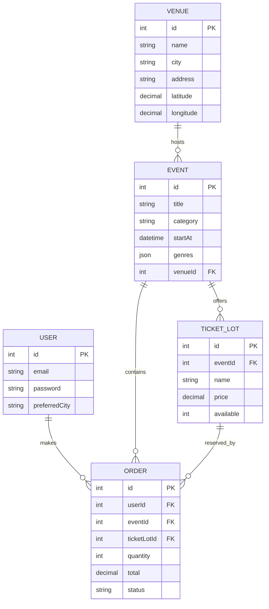

# Alfred: proposta, requisitos e próximos incrementos

## 1. Objetivo

Centralizar descoberta e compra de ingressos para cinema, shows, baladas, teatro, apresentações de dança e eventos culturais. Diferenciar-se por duas formas de descoberta: agenda por localização e sugestões compatíveis com preferências musicais, quando autorizado.

## 2. Perfis previstos

1. **Visitante:** explora eventos, filtra cidade, confere detalhes e preços.
2. **Comprador:** mantém conta, simula reserva na versão acadêmica e posteriormente comprará ingressos válidos.
3. **Organizador:** futuro painel para publicar espaços, eventos, datas e lotes.
4. **Administrador:** valida organizadores, modera eventos e supervisiona pedidos.

## 3. Telas disponíveis no protótipo

| URL | Tela | Fluxo |
| --- | --- | --- |
| `/` | Explorar | Destaques, categorias, cidade |
| `/cidade` | Minha cidade | Agenda local, localização autorizada, próximos eventos em cada espaço |
| `/seu-ritmo` | Seu Ritmo | Gêneros escolhidos, conexão Spotify opcional e sugestões |
| `/evento/:id` | Detalhe | Quando, onde, gêneros, lotes e simulação |
| `/login` | Login | Entrada com JWT |
| `/cadastro` | Cadastro | Criação de conta |
| `/meus-ingressos` | Reservas | Demonstrações locais ou registradas na API |
| `/spotify/callback` | Retorno Spotify | Finalização do OAuth2 PKCE |

## 4. Requisitos funcionais

- **RF01**: Usuários devem visualizar as seis categorias.
- **RF02**: Usuários devem filtrar eventos futuros por cidade, título e categoria.
- **RF03**: Usuários devem consultar os futuros eventos associados a cada espaço.
- **RF04**: A geolocalização deve ser opcional, dependente de permissão do navegador e permitir filtro por proximidade.
- **RF05**: Usuários devem consultar descrição, data, local, ingressos e valores de cada evento.
- **RF06**: A versão acadêmica deve permitir cadastro/login e reserva **somente demonstrativa**.
- **RF07**: Usuários devem escolher gêneros musicais sem conta externa.
- **RF08**: A conexão Spotify deve exigir consentimento e credenciais do app; não deve simular autorização bem-sucedida quando falhar.
- **RF09**: O recomendador deve considerar a interseção de gêneros, respeitar filtro de cidade e não inventar compatibilidade musical.
- **RF10**: A integração Apple Music ficará desabilitada até implantação real via MusicKit.

## 5. Critérios de aceitação para teste manual

1. Ao filtrar **Joinville + Dança**, aparecem somente eventos fictícios de dança em Joinville.
2. Ao filtrar uma cidade sem dados, aparece a mensagem de ausência, não uma lista inventada.
3. Ao negar permissão de localização, a busca manual continua funcionando.
4. Ao abrir um espaço em **Minha cidade**, os próximos eventos desse local são enumerados.
5. Ao selecionar **Eletrônica** em **Seu Ritmo**, eventos com esse gênero são priorizados.
6. Sem Client ID Spotify, o botão informa como configurar, sem exibir um falso perfil conectado.
7. Uma reserva indica visualmente **DEMO**, não gera QR Code, nem processa pagamento.
8. Com banco ativo, duas reservas concorrentes não devem ultrapassar a quantidade de ingresso disponível. Para validação rigorosa, executar teste de concorrência no banco escolhido.

## 6. Backlog sugerido por prioridade

**MVP acadêmico (esta entrega):** catálogo, filtros, agenda por local, simulação, preferências musicais, Spotify com configuração opcional.

**Segundo incremento:** painel CRUD de eventos e espaços, cadastro de organizadores, imagem para capa, perfil e favoritos, geocodificação de endereços reais, acessibilidade.

**Terceiro incremento:** gateway de pagamento, webhook e confirmação, expiração de reservas, QR Code e validação na portaria, e-mail transacional, rate limiting, LGPD, relatórios e testes automatizados.

**Quarto incremento:** MusicKit/Apple Music, recomendações personalizadas com feedback do usuário, classificação por distância real e alertas de novos eventos.

## 7. Entidades e relações

> O esboço acima reflete o banco demonstrativo atual. Uma venda real precisará de entidades de transação/pagamento, ingresso unitário, check-in, estorno, políticas de cancelamento e logs de auditoria.
